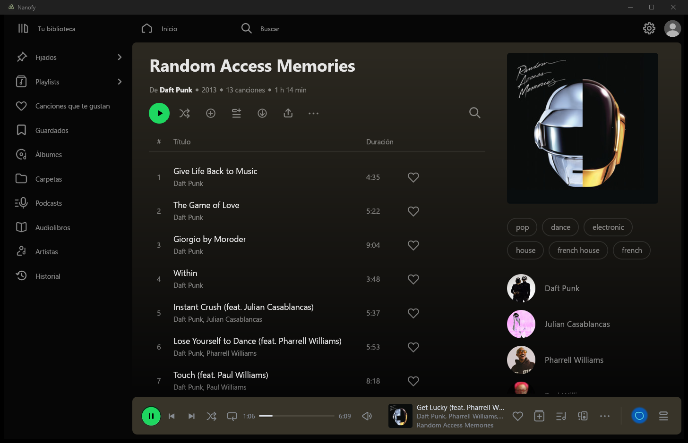
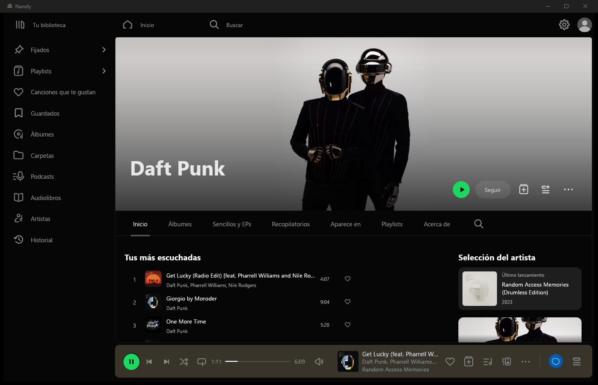
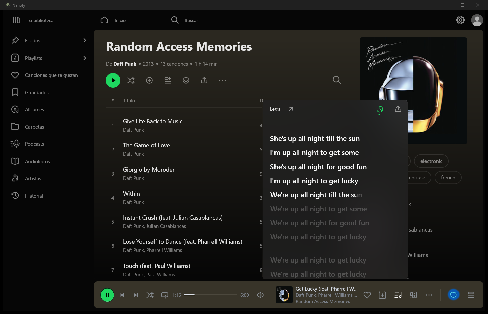
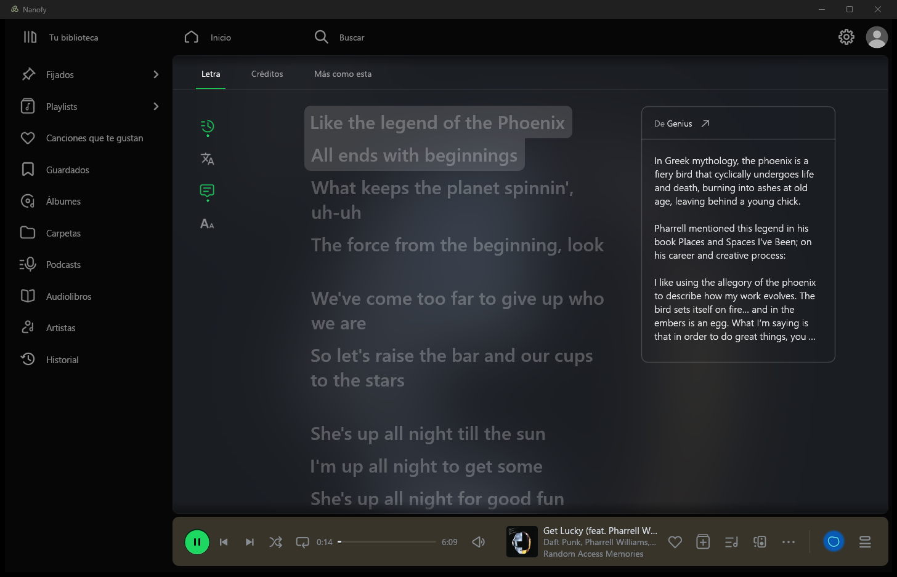
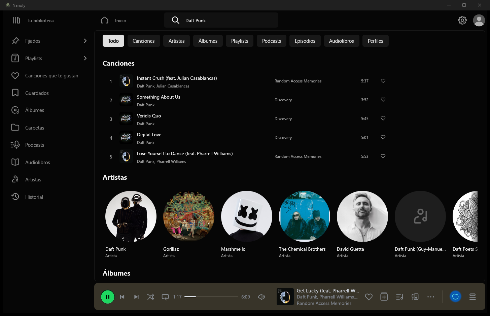

<p align="center"></p>

<h1 align="center">Nanofy</h1>

<p align="center"><b>A native, lightweight Spotify client for the desktop, written in Rust.</b><br>
No Electron, no webview, no GPU: ~14 MB of RAM and 0% CPU when idle.</p>

<p align="center">
  <a href="https://github.com/ElRobaMichis/nanofy/releases/latest"></a>
  <a href="https://github.com/ElRobaMichis/nanofy/releases"></a>
  <a href="https://github.com/ElRobaMichis/nanofy/actions/workflows/ci.yml"></a>
  
  <a href="LICENSE"></a>
</p>

<p align="center">
  <a href="#download">Download</a> ·
  <a href="#features">Features</a> ·
  <a href="#build-from-source">Build</a> ·
  <a href="#privacy-and-data">Privacy</a> ·
  <a href="CONTRIBUTING.md">Contributing</a> ·
  <a href="README.es.md">Español</a>
</p>

<p align="center"></p>

Nanofy plays Spotify in a native window. It draws its interface on the CPU, so it doesn't wake up the
graphics driver, and it uses no processor at all while idle. It shows up as one more Spotify Connect
device: you can control it from your phone, control your other devices from it, and start or join a
Jam. It runs on Windows, Linux and macOS. **Playback requires Spotify Premium.**

> [!NOTE]
> The interface is in **Spanish** for now. Everything in this README that you'll see on screen is
> quoted in Spanish, with its meaning next to it.

## Screenshots

<table>
  <tr>
    <td></td>
    <td></td>
  </tr>
  <tr>
    <td align="center">Artist page</td>
    <td align="center">Word-by-word synced lyrics</td>
  </tr>
  <tr>
    <td></td>
    <td></td>
  </tr>
  <tr>
    <td align="center">Song page with Genius annotations</td>
    <td align="center">Search with nine filters</td>
  </tr>
</table>

## Features

### Playback and sound

- Up to 320 kbps, volume normalization with Spotify's three levels, gapless playback and 1–12 s crossfade.
- Sinc resampling when the output device isn't at 44.1 kHz.
- Audio follows the system's default device (headphones, Bluetooth), even when it changes while paused.
- On startup it restores the last session, paused at the same second, with the queue, shuffle and repeat.
- **Spotify DJ**, with the host's voice between songs.
- Autoplay when a list ends, a sleep timer, and hidden songs that are always skipped.
- Pressing play on an artist plays your most-played songs by them first, then their popular ones, then similar music.

### Lyrics and songs

- Synced lyrics, word by word when available, from BiniLyrics, Musixmatch (via Lyrics+), LRCLIB or Spotify, all asked at once. Click a line to jump there.
- A page for every song: lyrics that follow the music, and Genius annotations on the verses that have them.

### Library and browsing

- Playlists: create, edit, change the cover, make them collaborative, organize them in folders and add songs to several at once.
- Liked songs, albums, artists, podcasts and history; song lists have multi-select and their own search box.
- Filter your liked songs by artist or genre and save the filter as a dynamic playlist that keeps itself up to date.
- Tabs with their own history, a customizable Home and search with nine filters.
- Search opens with your recent searches (the same as in the official app) and Spotify's categories grouped into Discover, Genres, Mood & activity, Entertainment, Podcasts and Audiobooks.
- Paste an `open.spotify.com` link or a `spotify:` URI into the search box to open it directly.

### Control and social

- Controllable from your phone like any Connect device; the «Reproducir en» (*Play on*) picker controls the others.
- Jam: create one, invite people, or join with a link or a code.

### System and reliability

- Media keys and the system's playback controls (with title and cover art) on Windows, Linux and macOS.
- An always-on-top miniplayer and, on Windows, playback buttons in the taskbar thumbnail.
- Connection drops are repaired in the background without stopping the music. If the network goes away, it pauses at that second and resumes when it comes back.
- Light, dark or system theme.
- <kbd>Ctrl</kbd>+<kbd>/</kbd> (<kbd>Cmd</kbd>+<kbd>/</kbd> on macOS) lists the keyboard shortcuts.

## Performance

Measured on October 7, 2026 with version 1.8.0 on Windows 11, an Intel Core i7 with 16 threads and an
RTX 3060 (the GPU isn't used). Memory, CPU, startup, exit and frame times are the median of three runs;
playback, playlist and search times also depend on the network.

| Measure | Value |
|---|---|
| Idle memory, signed in (working set / private) | 14 MB / 26 MB |
| Memory while playing (working set / private) | 22 MB / 55 MB |
| CPU idle / playing (of the whole processor) | 0% / 0.4% |
| From process start to a window with content | 55 ms (66 ms signed in) |
| From clicking × to the process exiting | 26 ms (60 ms while playing) |
| From pressing play to hearing the song | ~0.3 s |
| Opening a playlist seen before | < 0.1 s |
| Loading a whole 9,918-song playlist for the first time | 2.6 s |
| Search | ~1 s |
| Frame time while scrolling a list (1920×1040 window) | ~2 ms |
| Executable / Windows zip size | ~17 MB / ~8 MB |

## Download

Get the zip for your system from [Releases](https://github.com/ElRobaMichis/nanofy/releases/latest).
There's no installer.

| System | File |
|---|---|
| Windows 10 or 11, 64-bit | `Nanofy-windows-x64.zip` |
| Linux, x86-64 | `Nanofy-linux-x64.zip` |
| macOS 11 or later, Apple Silicon | `Nanofy-macos-arm64.zip` |
| macOS 11 or later, Intel | `Nanofy-macos-x64.zip` |

Every release includes `SHA256SUMS.txt` to verify the download (`sha256sum` on Linux,
`shasum -a 256` on macOS, `Get-FileHash` on Windows).

1. Unzip it into a folder you can write to, so Nanofy can update itself. On Windows, for example,
   `%LOCALAPPDATA%\Programs` (the zip already contains a `Nanofy` folder); not Program Files and not
   OneDrive. Don't run Nanofy from inside the zip.
2. Open Nanofy. On Linux it needs ALSA (`libasound2`) and OpenSSL 3; run it with
   `chmod +x nanofy && ./nanofy`. The binaries aren't signed, so Windows and macOS warn the first time:
   - Windows: on «Windows protected your PC», click «More info» and then «Run anyway».
   - macOS: try to open `Nanofy.app`, then click «Open Anyway» in System Settings → Privacy & Security
     (on macOS 14 or earlier, right-click → «Open» also works).
3. Click «Iniciar sesión con Spotify» (*Sign in with Spotify*) and accept in the browser. Sign-in uses
   OAuth with PKCE: Nanofy never sees your password, and you don't need to create a developer app.

### Updates

Nanofy checks for new versions on startup and every six hours with an anonymous request to GitHub. On
Windows and Linux it downloads the update in the background, verifies its size and SHA-256 and shows
«Reiniciar para actualizar» (*Restart to update*); if the new version doesn't start, Nanofy rolls back
by itself. On macOS it only lets you know. Both checking and installing can be turned off in Settings →
«Acerca de Nanofy» (*About Nanofy*).

## Build from source

You need Rust 1.95 or newer ([rustup](https://rustup.rs)) and, depending on your system:

- **Windows**: Visual Studio Build Tools with the C++ tools and the Windows SDK (MSVC toolchain, the default).
  Without admin rights, see [CONTRIBUTING.md](CONTRIBUTING.md#windows-without-admin-rights).
- **Debian/Ubuntu**: `sudo apt install build-essential pkg-config libasound2-dev libssl-dev libxkbcommon-dev libdbus-1-dev`
- **macOS**: `xcode-select --install`

```sh
git clone https://github.com/ElRobaMichis/nanofy
cd nanofy
cargo build --release
```

The executable ends up in `target/release/nanofy` (`nanofy.exe` on Windows); on macOS it's a plain
binary, not an `.app`. Copies run from `target/` don't update themselves: they offer «Instalar»
(*Install*) when there's a new version.

## Privacy and data

Nanofy has no telemetry and no servers of its own, and it doesn't accept connections from other
machines. It only talks to these services:

| Service | What for | What it receives |
|---|---|---|
| Spotify | Session, audio, library, search, cover art, Spotify Connect, Jam, DJ | The same as from any Spotify Connect device, including what's playing |
| [BiniLyrics](https://lrc.red), Lyrics+ (Musixmatch) and [LRCLIB](https://lrclib.net) | Lyrics, only while the lyrics panel or a song page is open | Title, artist, album and duration of the song (and of the next one, to have it ready) |
| [Genius](https://genius.com) | Annotations on the song page, only when you turn them on | Title and artist |
| Deezer, iTunes, MusicBrainz and Wikidata | Genres of albums, artists and songs | Only the artist, album or song names (and, for the genre filter of your liked songs, Deezer gets their ISRC codes) |
| GitHub | Checking for and downloading updates (can be turned off) | The installed version, without any account or token |

Like any server, all of these services see your IP address. Audio and cover art are fetched from the
addresses Spotify gives, normally its CDN.

| Data | Windows | Linux | macOS |
|---|---|---|---|
| Settings | `%APPDATA%\nanofy\config` | `~/.config/nanofy` | `~/Library/Application Support/nanofy` |
| Session, credentials, library copy and `nanofy.log` | `%LOCALAPPDATA%\nanofy\data` | `~/.local/state/nanofy` | `~/Library/Application Support/nanofy` |
| Audio, cover art and list cache | `%LOCALAPPDATA%\nanofy\cache` | `~/.cache/nanofy` | `~/Library/Caches/nanofy` |

Credentials and tokens are stored as unencrypted JSON, not in the system keychain. «Cerrar sesión»
(*Sign out*, in Settings → «Cuenta») deletes the saved session but not the library access, which is
removed with «Desconectar» (*Disconnect*) in Settings → «Biblioteca».

### Uninstall

Nanofy doesn't write to the Windows registry or create shortcuts. Delete the folder you unzipped it
into and the ones in the table above (on Windows, `%APPDATA%\nanofy` and `%LOCALAPPDATA%\nanofy`). If you
want, also revoke its access on your Spotify account's apps page.

## Limitations

- Without Premium nothing plays: you can only browse your library, search and manage playlists.
- No lossless audio: Spotify's FLAC is DRM-protected. The maximum is 320 kbps.
- Search, Home, playlists, lyrics, DJ and Jam use internal, undocumented APIs that Spotify can change.
- Lyrics aren't available for every song, and Genius doesn't have annotations for all of them.
- «Descargar» (*Download*) keeps the audio in the disk cache, but it isn't an offline mode: playing it still needs the network, and the cache can drop it when it fills up.
- Songs can't be reordered by dragging, and there's no system tray icon.
- Automated tests only run on Windows; the Linux and macOS builds are compiled on every change but not tested.

## Reporting a bug

Open an [issue](https://github.com/ElRobaMichis/nanofy/issues/new/choose) (English or Spanish) with
the version (Settings → «Acerca de Nanofy»), your system and the steps to reproduce it, and attach
`nanofy.log` and `nanofy.log.1` from the data folder above. Review them before posting: they include
your Spotify username and may include song titles. Security problems go
[privately](SECURITY.md).

## Contributing

Pull requests are welcome. [CONTRIBUTING.md](CONTRIBUTING.md) explains how to build, test and send
changes, and how the code is organized.

## Credits and license

Nanofy is built on [librespot](https://github.com/librespot-org/librespot) (with its own patches in
`vendor/`), [egui](https://github.com/emilk/egui), [winit](https://github.com/rust-windowing/winit),
[softbuffer](https://github.com/rust-windowing/softbuffer), [rodio](https://github.com/RustAudio/rodio),
[Symphonia](https://github.com/pdeljanov/Symphonia) and [souvlaki](https://github.com/Sinono3/souvlaki).
Lyrics from BiniLyrics, Musixmatch (via Lyrics+) and [LRCLIB](https://lrclib.net); annotations from
[Genius](https://genius.com); genres from Deezer, iTunes, MusicBrainz and Wikidata.

[MIT](LICENSE) license. Nanofy is an independent project and isn't affiliated with Spotify. Spotify is
a trademark of Spotify AB.
